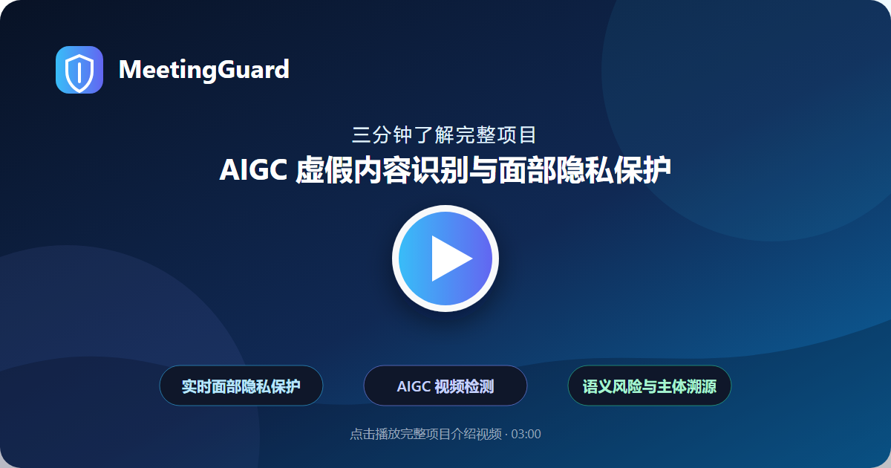
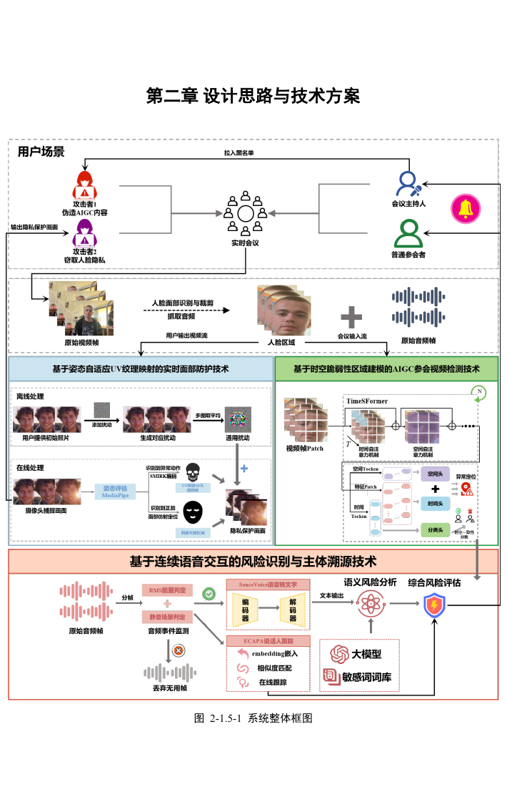
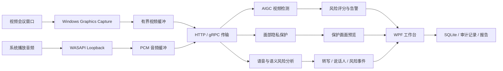
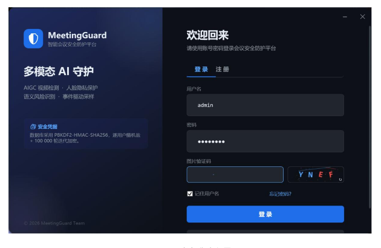
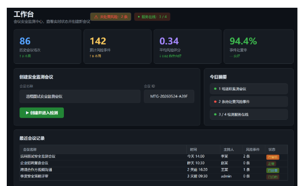
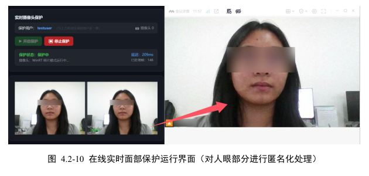
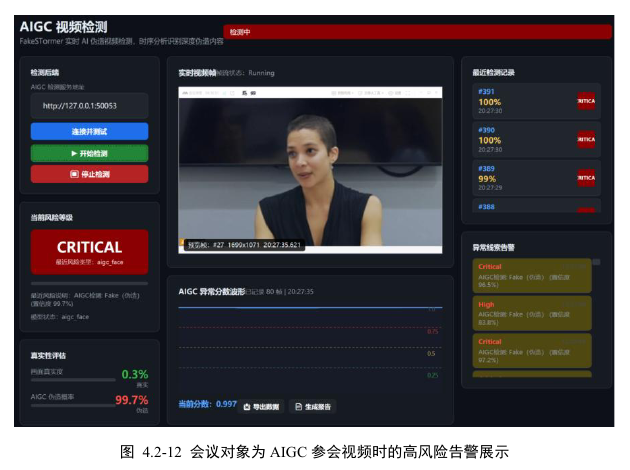
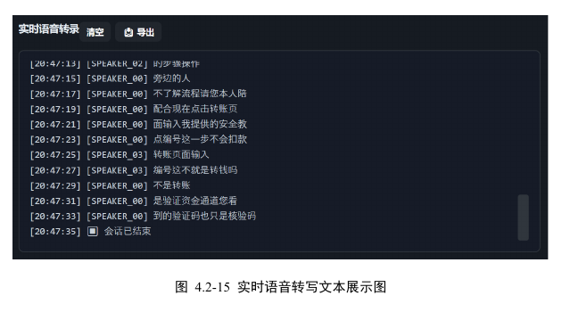
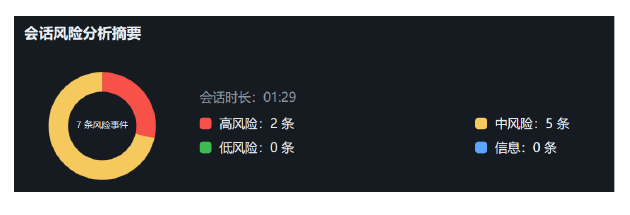
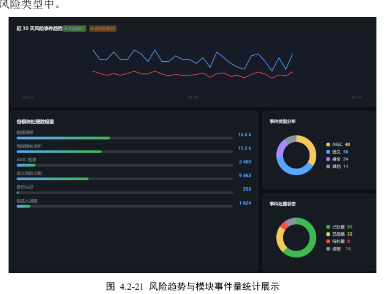

<div align="center">

# MeetingGuard

### 面向视频会议的 AIGC 虚假内容识别与面部隐私保护

面向远程办公、在线招聘、政务协同等高信任视频会议场景，构建覆盖
**主动隐私保护、虚假视频检测、语义风险识别与会后审计**的多模态安全防护闭环。


</div>

## 🎬 三分钟项目介绍

<p align="center">
  <a href="https://github.com/volcano557/MeetingGuard/releases/download/project-demo-v1/3min.mp4">
    
  </a>
</p>

<p align="center">
  <a href="https://github.com/volcano557/MeetingGuard/releases/download/project-demo-v1/3min.mp4"><strong>▶ 点击封面观看或下载完整介绍视频（MP4，88.3 MB）</strong></a>
  <br />
  <a href="https://github.com/volcano557/MeetingGuard/releases/tag/project-demo-v1">查看视频发布页与项目简介</a>
</p>

> GitHub README 不提供稳定的内嵌视频播放器，因此视频以 Release 资产保存，并通过可点击封面访问。这样既保留原始画质，也不会让大文件进入 Git 历史、拖慢仓库克隆。

## 项目简介

生成式人工智能使换脸、数字人、语音克隆和诱导式风险话术更容易进入实时会议。传统方案通常只解决会前认证或会后取证，难以同时覆盖会议中的身份冒用、人脸隐私泄露与内容风险传播。

MeetingGuard 将会议窗口视频与系统音频作为统一的实时数据流，围绕“采集 - 分析 - 预警 - 留痕”构建三条核心能力链：

1. **保护真实参会者**：在尽量保持画面自然性和交互可用性的前提下，对人脸身份特征施加实时保护。
2. **识别虚假参会内容**：联合建模视频的空间脆弱区域与时间一致性，检测换脸、数字人和篡改画面。
3. **发现会议内容风险**：融合流式语音转写、语义分析、敏感词规则和说话人表征，定位风险话术及其发言主体。

> [!IMPORTANT]
> 本仓库是作品的 **Windows 前端/桌面客户端**，当前实现采用 `.NET 8 + WPF`。完整作品还包含独立部署的面部保护、AIGC 视频检测、语音识别与语义分析后端；这些模型和服务端代码不在本仓库中。

## 核心成果

以下数据来自《作品设计文档》中的实验与功能测试，用于说明完整作品的算法效果；它们不是本客户端仓库的自动化 CI 基准。

| 能力 | 测试设置 | 结果 | 说明 |
| --- | --- | ---: | --- |
| 实时面部保护 | UV 映射、隔帧缓存与平面仿射协同 | **约 30 FPS** | 达到常见视频会议 15-30 FPS 的实时范围 |
| 面部保护有效性 | DiffFace / DiffSwap / FaceSwap | **L2、ISM、PSNR 均优于对比方法** | 在 AdvDM、PhotoGuard 对照实验中均取得更优指标 |
| AIGC 视频检测 | FF++ C23，人脸裁剪输入 | **AUROC 99.79% / mF1 95.47%** | 人脸裁剪显著减少背景干扰 |
| 压缩场景鲁棒性 | FF++ C40，DF / FS / F2F / NT | **平均 AUROC 99.85%** | 面向网络传输和二次压缩场景 |
| 扩散换脸泛化 | Celeb-DFv2 + DiffSwap 自建验证集 | **AUROC 97.7%** | 较 SBI、LAA-Net 分别高 7.1、5.6 个百分点 |
| 中文语音转写 | OpenSLR 68，200 条语音 | **CER 6.17% / RTF 0.0543** | 70% 样本实现整句完全正确 |
| 语义风险识别 | ChineseHarm-Bench，300 条文本 | **F1 95.18%** | 准确率 92.33%，查准率 100%，召回率 90.80% |
| 说话人表征 | 3 名说话人，163 个有效片段 | **类内相似度 0.593** | 高于类间相似度 0.362，具备主体区分能力 |

## 系统全景

<p align="center">
  
</p>

完整作品由用户侧采集客户端、AI 算法服务与风险治理链路组成：客户端负责稳定获取会议音视频、管理会话并展示结果；后端完成面部保护、视频真伪检测、语音转写、说话人分析和语义风险研判；检测结果最终回流客户端形成实时告警、事件时间线和统计审计。



## 产品展示

### 身份认证与安全工作台

客户端提供注册、登录、图片验证码和本地密码加盐哈希存储。工作台聚合会议状态、风险事件、近期记录与快速检测入口。

<table>
  <tr>
    <td width="50%"></td>
    <td width="50%"></td>
  </tr>
  <tr>
    <td align="center">身份认证</td>
    <td align="center">安全工作台</td>
  </tr>
</table>

### 面部隐私保护与 AIGC 视频检测

面部保护模块采用“离线生成专属扰动模板 + 在线动态映射”的方式，将通用扰动随头部姿态稳定投射到面部区域。AIGC 检测模块持续分析会议画面，在发现高风险伪造内容时输出真实性分数、风险等级和弹窗告警。

<table>
  <tr>
    <td width="50%"></td>
    <td width="50%"></td>
  </tr>
  <tr>
    <td align="center">在线面部隐私保护</td>
    <td align="center">AIGC 视频真实性检测</td>
  </tr>
</table>

### 实时语义风险与会后分析

系统将会议音频实时转写为带时间戳和说话人标签的文本，结合大模型语义判断与本地敏感词规则生成风险事件。会话结束后可汇总风险等级、事件类型和模块运行趋势，支持复盘与审计。

<p align="center">
  
</p>

<table>
  <tr>
    <td width="40%"></td>
    <td width="60%"></td>
  </tr>
  <tr>
    <td align="center">会话风险汇总</td>
    <td align="center">风险趋势与事件统计</td>
  </tr>
</table>

## 三项关键技术

### 1. 姿态自适应 UV 纹理映射的实时面部保护

- **离线多目标对抗优化**：同时针对扩散生成通路、人脸检测器和身份特征提取器构造扰动，兼顾攻击迁移性与视觉自然性。
- **用户专属通用模板**：对多姿态样本归一化并聚合，使模板能够在截图、录屏和跨帧场景中重复使用。
- **在线动态贴合**：通过人脸姿态估计、UV 纹理映射和面部掩膜，将扰动稳定附着到不同视角下的人脸表面。
- **实时工程优化**：隔帧更新人脸框、UV 场和掩膜，并以平面仿射作为快速路径，将在线处理提升到约 30 FPS。

### 2. 时空脆弱性区域建模的 AIGC 视频检测

- **高质量时序伪造样本**：通过自混合视频构造机制生成跨帧一致的训练样本，避免模型只记忆特定生成器伪影。
- **空间脆弱性分支**：关注眼部、嘴部、面部边界等易产生局部纹理和结构异常的区域。
- **时间脆弱性分支**：建模连续帧中的运动和表情演化，捕捉单帧自然但跨帧不协调的异常。
- **压缩鲁棒性**：面向视频会议常见的有损传输与二次压缩进行评估，在 FF++ C40 上获得 99.85% 平均 AUROC。

### 3. 连续语音交互的风险识别与主体溯源

- **流式触发切分**：依据音量阈值、连续静音和最小时长切分有效语句，减少背景噪声与短促片段误触发。
- **语音转写**：使用 SenseVoice 类 ASR 链路提供低时延中文转写，为语义分析持续输入结构化文本。
- **说话人跟踪**：基于 ECAPA-TDNN 嵌入和在线相似度匹配，为每段语音关联发言主体。
- **双路风险融合**：将大模型语义风险分数与本地敏感词规则按 `0.7 : 0.3` 融合，输出正常、可疑、高危三级结果。

## 本仓库实现

客户端采用分层、模块化设计，各项目通过接口和依赖注入协同工作：

| 项目 | 职责 | 关键实现 |
| --- | --- | --- |
| `MeetingAgent.App` | WPF 应用与业务编排 | MVVM、登录注册、工作台、预览、SQLite、会话控制 |
| `MeetingAgent.Core` | 领域模型与抽象接口 | 配置模型、采集/传输/告警契约、状态定义 |
| `MeetingAgent.Capture` | Windows 视频采集 | Windows Graphics Capture、Direct3D 11、窗口发现 |
| `MeetingAgent.Audio` | 系统音频采集 | WASAPI Loopback、NAudio、16-bit PCM 重采样与分块 |
| `MeetingAgent.Transport` | 后端通信 | HTTP、gRPC、Protobuf、LZ4、心跳与重连 |
| `MeetingAgent.Alerting` | 风险通知 | 分级告警、冷却控制、事件分发 |
| `MeetingAgent.Infrastructure` | 通用基础设施 | 配置、日志、系统信息、状态存储 |

采集链路采用音视频双路并行和有界队列解耦。当短时负载升高时，队列优先丢弃最旧数据并保留最新数据，以控制端到端延迟。视频帧默认以 BGRA8 表示，可选择 LZ4 无损压缩；音频统一为 16 kHz、单声道、16-bit PCM，并按固定时间窗发送。

## 快速开始

### 环境要求

- Windows 10 2004（Build 19041）或更高版本
- [.NET 8 SDK](https://dotnet.microsoft.com/download/dotnet/8.0)
- Visual Studio 2022，并安装“.NET 桌面开发”工作负载（推荐）
- 可访问的检测后端；仅查看界面或联调传输时可使用仓库中的 mock server

### 构建与运行

```powershell
git clone https://github.com/volcano557/MeetingGuard.git
cd MeetingGuard

dotnet restore MeetingAgent.sln
dotnet build MeetingAgent.sln --configuration Release
dotnet run --project .\src\MeetingAgent.App\MeetingAgent.App.csproj
```

### 服务配置

默认配置文件位于 [`src/MeetingAgent.App/appsettings.json`](src/MeetingAgent.App/appsettings.json)：

| 配置段 | 默认地址 | 用途 |
| --- | --- | --- |
| `Gateway` | `http://127.0.0.1:8000` | 统一服务入口 |
| `FaceProtect` | `http://127.0.0.1:5001` | 面部隐私保护服务 |
| `SemanticRisk` | `http://127.0.0.1:8003` | 语义风险分析服务 |
| `LinuxBackend` | `http://127.0.0.1:50053` | AIGC 检测与音视频处理后端 |

如需本地联调，请参考 [`tools/mock-server/README.md`](tools/mock-server/README.md)。客户端同时支持 HTTP 与 gRPC；具体协议、压缩方式、帧率、分辨率、超时和重连参数均可在配置文件中调整。

## 目录结构

```text
MeetingGuard/
├── docs/images/                     # README 架构图与运行截图
├── src/
│   ├── MeetingAgent.App/            # WPF 桌面应用
│   ├── MeetingAgent.Core/           # 领域模型与接口
│   ├── MeetingAgent.Capture/        # 视频窗口采集
│   ├── MeetingAgent.Audio/          # 系统音频采集
│   ├── MeetingAgent.Transport/      # HTTP/gRPC 传输
│   ├── MeetingAgent.Alerting/       # 风险告警
│   └── MeetingAgent.Infrastructure/ # 配置、日志和状态
├── tools/mock-server/               # Python mock gRPC 服务
├── Directory.Build.props
└── MeetingAgent.sln
```

## 实验说明

- 人脸保护实验覆盖 DiffFace、DiffSwap、FaceSwap，并与 AdvDM、PhotoGuard 对比。
- 视频检测实验使用 FaceForensics++ C23/C40、Celeb-DFv2 以及 DiffSwap 构造的扩散换脸验证样本。
- 语音转写实验使用 OpenSLR 68 MAGICDATA 普通话语音测试集。
- 语义风险实验使用 ChineseHarm-Bench，覆盖欺诈、黑产广告、博彩、低俗色情、谩骂引战等类别。
- 报告中的性能结果与截图来自竞赛作品测试环境，实际性能会受到硬件、后端模型、会议平台和网络状况影响。

## 隐私与安全

- 请在获得参会者授权并遵守适用法律、平台规则和组织制度的前提下采集会议音视频。
- `meetingguard.db`、日志、审计导出和本地密钥已在 `.gitignore` 中排除，不应提交真实会议数据。
- `appsettings.json` 中的 `AuthToken` 默认为空。生产部署应通过安全配置渠道注入凭据，不要将令牌写入仓库。
- 当前项目是竞赛与研究原型，部署到真实业务前应补充威胁建模、权限隔离、传输加密、密钥管理和安全审计。

## 应用场景

- 远程招聘与线上身份核验
- 企业敏感会议与远程审批
- 政务协同与应急指挥
- 金融沟通、反诈提醒与合规审查
- 在线教育、远程答辩与数字内容治理

---

MeetingGuard 希望将视频会议安全从“会后取证”推进到“会中主动防护”：既保护真实参会者，也识别虚假参会内容，并让风险事件可解释、可追踪、可复盘。
